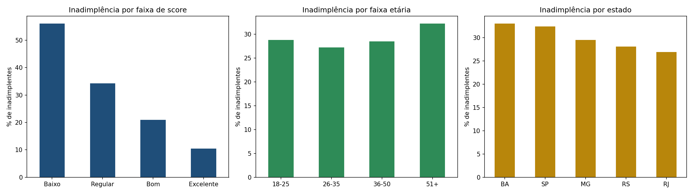

# Análise Exploratória de Inadimplência

Projeto de portfólio em Python que analisa a relação entre **score de crédito, idade, renda e estado** com a **inadimplência** em uma carteira de clientes.

> Os dados são **fictícios**, gerados pelo próprio script, apenas para fins de estudo.

## O que o projeto faz

1. Gera uma base simulada de 1.000 clientes
2. Inspeciona os dados (`head`, `info`, `describe`, valores ausentes)
3. Faz a limpeza (renda negativa e valores nulos)
4. Cria faixas de score e de idade
5. Calcula a taxa de inadimplência por score, idade e estado
6. Gera gráficos e exporta a base tratada em CSV

## Tecnologias

- Python 3
- pandas
- NumPy
- Matplotlib

## Como executar

```bash
pip install pandas numpy matplotlib
python analise_credito.py
```

## Resultados gerados

- `grafico_inadimplencia.png`: gráficos de inadimplência por faixa de score, faixa etária e estado
- `base_tratada.csv`: base após a limpeza
- 

## Principais aprendizados

- Limpeza de dados com `fillna` e tratamento de valores inválidos
- Agrupamentos com `groupby`
- Categorização com `pd.cut`
- Visualização com Matplotlib

## Próximos passos

- Aplicar um teste estatístico para validar as diferenças entre grupos
- Treinar uma regressão logística para prever inadimplência
- Repetir a análise com uma base pública real

## Autora

Carolina Santana de Faria
